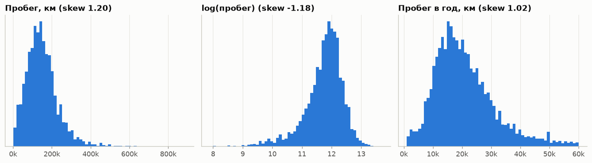
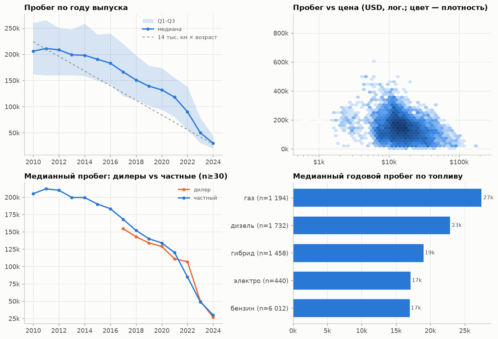
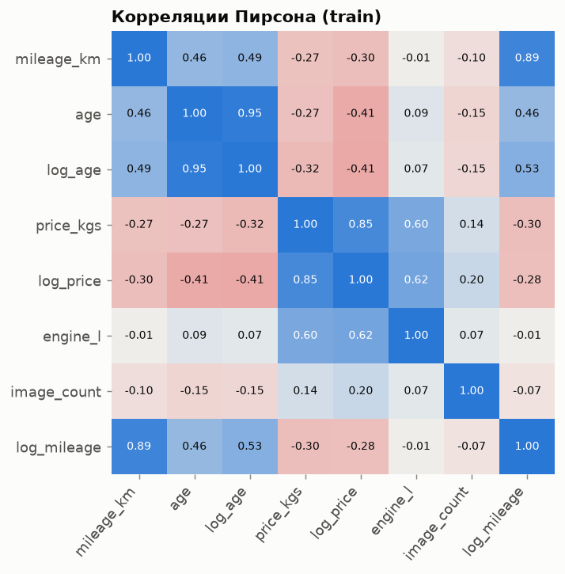
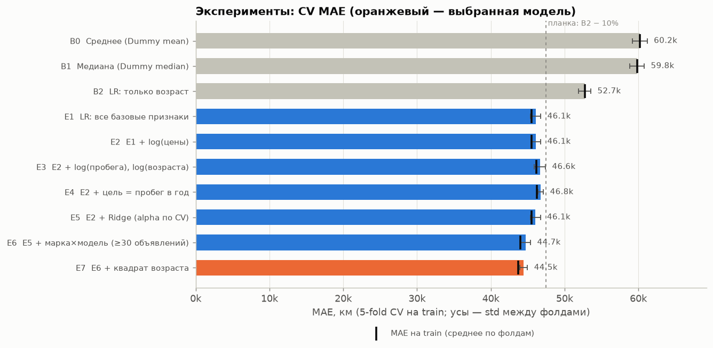
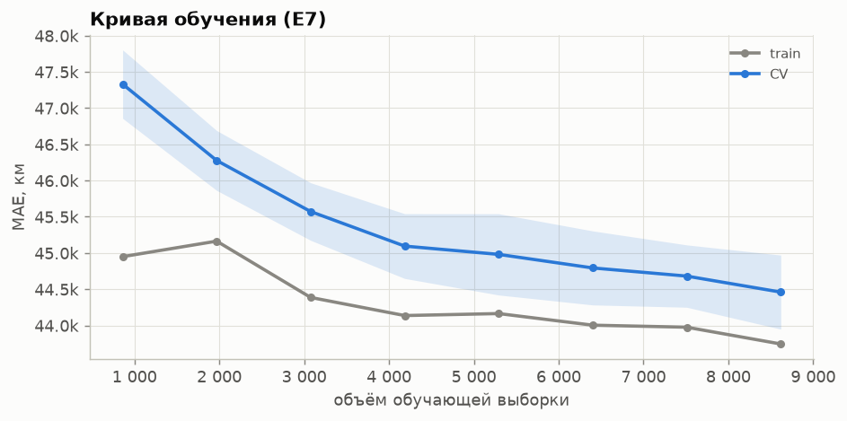
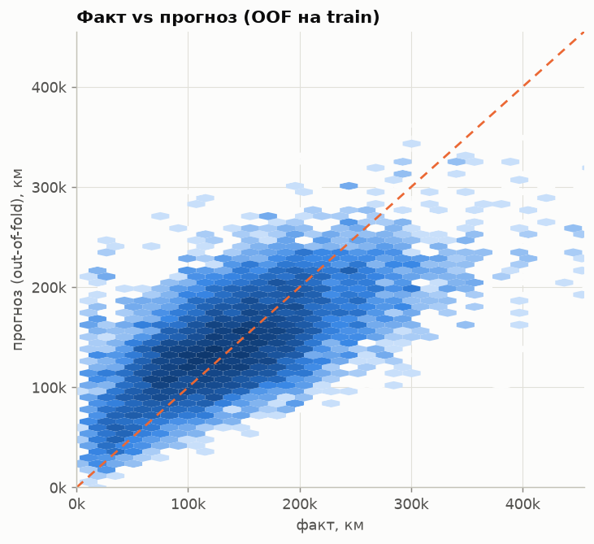
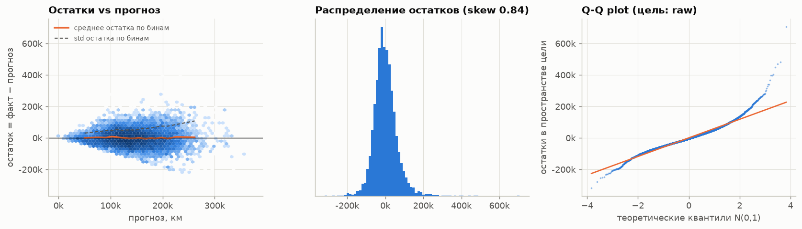
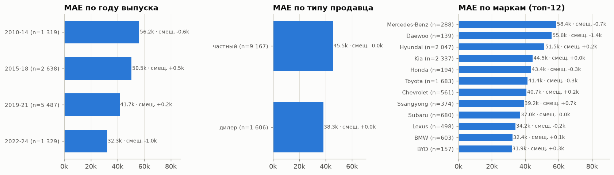
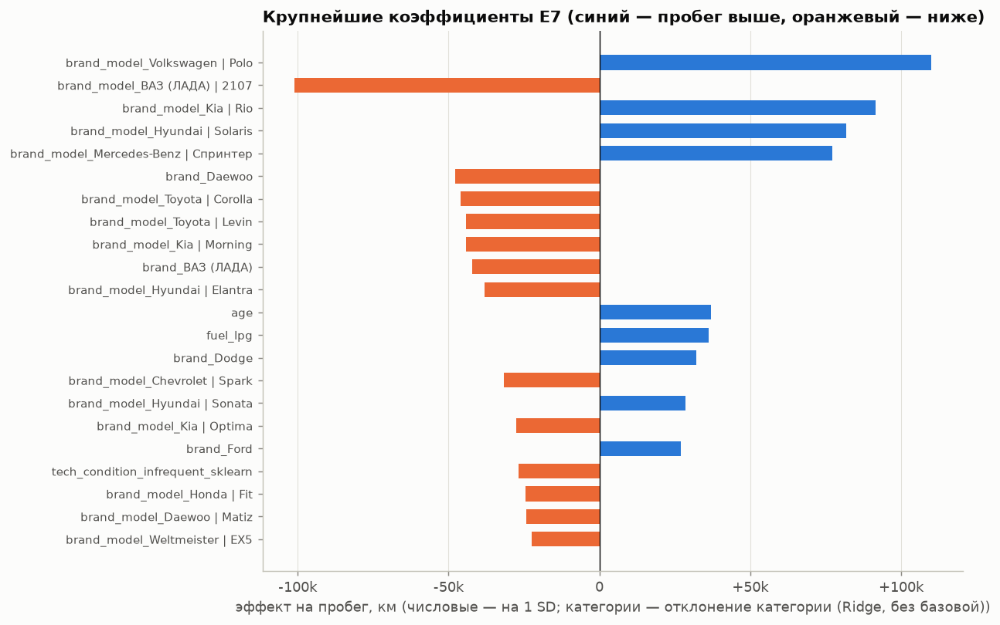

# Пилот: прогноз пробега линейными моделями

Пилотная итерация по чек-листу `linear_regression_checklist.md`. Цель — получить честные замеры:
бейзлайны, проверенные гипотезы, CV и один прогон на тесте. Следующие итерации с признаками
будут сравниваться с этими цифрами на **том же тестовом наборе**.

**Воспроизведение:**

```bash
venv/bin/python mileage/build_dataset.py   # ~20 с: таблица + фиксированный train/test сплит
venv/bin/python mileage/pilot.py           # ~2 мин: эксперименты, тест, диагностика, графики
```

**Файлы:**
- `mileage/data/` — таблица для модели и сводка по выборке;
- `mileage/results/experiments.csv` — журнал экспериментов (сюда же пойдут следующие итерации);
- `pilot_summary.json`, `ols_summary.txt`, `final_model.joblib`;
- графики — в `mileage/fig/`.

---

## Итог в пяти строках

1. На тесте модель ошибается **в среднем на 44,1 тыс. км** (MAE). Это ≈ 31 % от медианного
   пробега (140 тыс. км). У половины машин ошибка меньше 35 тыс. км, R² = 0,44.
2. Это **на 16 % лучше**, чем линейная регрессия только по возрасту (52,3 тыс. км), и на 26 % лучше
   константы (59,9 тыс.). Заранее заданная планка «≥ 10 % лучше бейзлайна по возрасту» пройдена.
3. Тест совпал с кросс-валидацией: 44,1 против 44,5 тыс. км, разница −0,8 % при допуске ±5 %.
   Признаков утечки или переобучения нет.
4. **Модель недообучена.** Train и CV почти равны (43,7 и 44,5 тыс.), кривая обучения почти
   выровнялась, а лучший прирост дала детализация до конкретной модели (такси-модели
   и машины на газу ездят больше). Главный рычаг — признаки и взаимодействия, а не объём данных.
5. Долгосрочная цель ≤ 35 тыс. км не достигнута. Мешает ей и шум в самой целевой переменной:
   округлённые значения, заглушки вида 55 555, сброс пятизначного одометра у классических ВАЗ.

---

## Этап 1. Постановка задачи

**Предсказываем пробег (км) подержанного автомобиля 2010–2024 годов выпуска по характеристикам
объявления, чтобы оценить пробег там, где продавец его не указал, и получить «ожидаемый» пробег
для сравнения с заявленным.**

- Задача — регрессия: цель `mileage_km` числовая, от 2,7 тыс. до 888 тыс. км.
- Единица наблюдения — одна уникальная машина. Повторы одной машины удалены через `dup_cluster`
  из EDA.
- **Метрики выбраны до обучения:**
  - главная — **MAE в км** («в среднем ошибаемся на X км»);
  - дополнительные — RMSE, R², MedAE (медианная ошибка), MAPE.

  MAPE как главную не берём: у молодых машин маленький пробег, и процент ошибки раздувается.
- **«Достаточно хорошо» (зафиксировано в `pilot.py` до прогона):**

  | критерий | планка | результат |
  |---|---|---|
  | CV MAE лучше бейзлайна «LR по возрасту» (B2) | ≥ 10 % | **15,7 %** ✅ |
  | MAE на тесте близок к CV MAE | ±5 % | **−0,8 %** ✅ |
  | долгосрочная цель следующих итераций | MAE ≤ 35 тыс. км | 44,1 тыс. ❌ |

- Нужна интерпретируемость, поэтому модели линейные: LinearRegression и Ridge.

## Этапы 2–4. Данные, очистка, EDA

Общий EDA датасета — в `EDA/eda_report.md`. Здесь — то, что касается этой задачи.

**Воронка отбора** (`mileage/data/build_summary.json`):

| шаг | строк |
|---|---:|
| все объявления | 54 518 |
| без «Других автомобилей» (запчасти, спецтехника, мусор) | 53 644 |
| без повторов одной машины | 51 392 |
| год выпуска 2010–2024 | 18 482 |
| пробег указан и прошёл очистку `prep.py` (тысячи км ×1000, > 1 млн → пропуск) | 13 957 |
| пробег ≥ 1 000 км | 13 707 |
| годовой пробег 1–60 тыс. км (логически невозможные значения) | **13 467** |

Последние два фильтра — **правила логической корректности** (этап 3.4 чек-листа),
а не статистическое удаление выбросов. Они применяются одинаково ко всем строкам до разбиения,
по ним отсеяно 490 строк. Реальные редкие значения (500–900 тыс. км у такси) остались в данных.

**Признаки** (всё известно в момент публикации объявления; идентификаторы и `mileage_rule`
в модель не входят):

| группа | признаки | обработка |
|---|---|---|
| числовые | `age` = 2026 − год, `engine_l`, `price_kgs` или `log_price`, `image_count` | медиана + флаг пропуска, StandardScaler |
| категориальные | `brand`, `body_type`, `transmission`, `drive`, `steering_wheel`, `condition`, `tech_condition` (худшая из отмеченных), `customs_cleared`, `registration_country`, `region`, `seller`, `currency`, `is_vip` | пропуск → `"unknown"`, one-hot, категории < 30 объявлений → «прочие» |
| мультивыбор топлива | `fuel_petrol/diesel/lpg/hybrid/ev`, `fuel_isna` | 0/1 (машина может быть «бензин + газ») |
| добавлены в экспериментах | `brand_model` (≥ 30 объявлений), `(age − 7)²` | — |

Признаков на модель — 78–166, строк на признак — 65–140. Это выше ориентира чек-листа
(10–20 строк на признак).



**Целевая переменная** скошена вправо (skew 1,2). Логарифм перекашивает её влево (−1,18),
годовой пробег — вправо (1,0). Ни одно преобразование не делает распределение симметричным,
поэтому форму цели проверяем как гипотезу (H2, H3).



- **Пробег растёт с возрастом вогнуто.** Для машин 2012–2023 годов медиана выше линии
  «14 тыс. км × возраст» (на 30–48 тыс. для 2014–2021), а к 2010–2011 годам упирается
  в ~200–210 тыс. Отсюда гипотеза H6 (квадрат возраста). Часть этого «насыщения» может быть смещением: у старых машин большой пробег
  чаще не указывают (см. EDA, раздел о пропусках).
- **Цена связана с пробегом отрицательно** (r = −0,30 с лог-ценой): при прочих равных
  машина с большим пробегом дешевле.
- **Дилеры** продают машины 2017–2021 годов с пробегом на 5–15 тыс. км ниже, чем частники.
- **Газ — признак такси.** Медианный годовой пробег у машин на газу 27 тыс. км, у дизельных
  23 тыс., у бензиновых и электромобилей 17 тыс.



Среди числовых признаков опасных пар нет: |r| > 0,8 только у пар «признак ↔ его логарифм»,
а они в одну модель не попадают. Корреляция возраста с пробегом 0,46 (с log-возрастом 0,49),
объём двигателя с пробегом не связан (r ≈ 0).

## Этап 5. Разбиение

- **Train 10 773 / test 2 694 (80/20)**, стратификация по возрастной группе (2010–14 / 15–18 /
  19–21 / 22–24), `random_state = 42`.
- **Метка сплита сохранена в таблице.** Все будущие эксперименты будут оцениваться на тех же
  2 694 машинах.
- Распределения цели совпадают: медиана 140 тыс. км в обеих частях, среднее 148,8 и 149,4 тыс.,
  Q1–Q3 95–190 тыс.
- Повторы одной машины удалены до сплита, поэтому одна машина не может оказаться и в train,
  и в test.
- Все выборы (признаки, форма цели, alpha) делаются **только по 5-fold CV на train**,
  на одних и тех же фолдах. Поэтому эксперименты сравниваются попарно.

## Этапы 6–8, 11. Гипотезы и эксперименты

Каждый эксперимент меняет одну вещь. Предобработка — `Pipeline` + `ColumnTransformer`:
импутация и масштабирование обучаются только на train каждого фолда.

- Для `LinearRegression` one-hot строится с `drop="first"`, чтобы избежать ловушки
  фиктивных переменных.
- Для Ridge используется `drop=None`: штраф сам снимает коллинеарность, и у каждой категории
  остаётся свой читаемый коэффициент.
- Alpha для Ridge подбирается внутри каждого фолда (`RidgeCV`, 71 значение от 10⁻³ до 10⁴).



| id | эксперимент | CV MAE, тыс. км | train MAE | CV RMSE | CV R² | CV MedAE | признаков | alpha |
|---|---|---:|---:|---:|---:|---:|---:|---:|
| B0 | среднее (Dummy mean) | 60,2 ± 1,0 | 60,2 | 80,0 | 0,000 | 48,8 | 0 | |
| B1 | медиана (Dummy median) | 59,8 ± 1,0 | 59,8 | 80,5 | −0,012 | 47,6 | 0 | |
| B2 | LR: только возраст | 52,7 ± 0,8 | 52,7 | 70,9 | 0,213 | 42,8 | 1 | |
| E1 | LR: все базовые признаки | 46,1 ± 0,7 | 45,5 | 62,7 | 0,385 | 35,7 | 78 | |
| E2 | E1 + log(цены) | 46,1 ± 0,7 | 45,5 | 62,7 | 0,385 | 35,7 | 78 | |
| E3 | E2 + цель log(пробег), log(возраст) | 46,6 ± 0,8 | 46,1 | 64,9 | 0,341 | 34,8 | 78 | |
| E4 | E2 + цель «пробег в год» | 46,8 ± 0,4 | 46,2 | 63,5 | 0,369 | 36,1 | 78 | |
| E5 | E2 + Ridge | 46,1 ± 0,7 | 45,5 | 62,7 | 0,385 | 35,5 | 91 | 7,9 |
| E6 | E5 + марка×модель | 44,7 ± 0,7 | 44,0 | 60,7 | 0,423 | 34,5 | 150 | 6,3 |
| **E7** | **E6 + квадрат возраста** | **44,5 ± 0,5** | **43,7** | **60,4** | **0,429** | **34,2** | 151 | 6,3 |

± — стандартное отклонение MAE между 5 фолдами.

**Гипотезы и вердикты:**

| | гипотеза | результат | вердикт |
|---|---|---|---|
| — | Признаки объявления добавляют к возрасту | E1 против B2: −6,6 тыс. км (−12,6 %) | ✅ главный прирост |
| H1 | Связь с ценой мультипликативная → лог-цена | 46,10 против 46,09 | ❌ без эффекта; лог-цена оставлена: она устойчивее к хвосту дорогих машин |
| H2 | Пробег = возраст^b × интенсивность → регрессия в логарифмах | +0,55 тыс. хуже по MAE и R², MedAE чуть лучше | ❌ для MAE. Обратное преобразование даёт «типичный» (геометрический) пробег, а он систематически ниже |
| H3 | Цель — годовой пробег, прогноз = ставка × возраст | +0,67 тыс. хуже, но наименьший разброс между фолдами (±0,36) | ❌ сейчас; вернуться вместе со взаимодействиями |
| H4 | Ridge стабилизирует one-hot | 46,06 против 46,10 | ➖ нейтрально: при 78 признаках переобучения нет. Ridge нужен как основа для более широких наборов |
| H5 | Конкретная модель задаёт интенсивность эксплуатации | −1,35 тыс. (≈ 2 std фолдов) | ✅ лучший шаг после базовых признаков |
| H6 | Годовой пробег меняется с возрастом нелинейно | −0,25 тыс. (меньше std фолдов) | ✅ слабо; оставлен, эффект интерпретируем |

**Выбрана модель E7** — минимум CV MAE среди моделей E1–E7. По качеству она почти не отличается
от E6, разница 0,25 тыс. км.

## Этап 9. Качество выбранной модели (CV)



**Диагноз — недообучение (high bias).**

- Train MAE 43,7 тыс. и CV MAE 44,5 тыс. почти равны. По таблице 9.2 чек-листа это
  «train плохо, val плохо».
- Кривая обучения: CV MAE падает с 47,3 тыс. (861 машина) до 44,5 тыс. (8 618). Падение
  замедляется: последние +1 000 строк дали ~0,1–0,2 тыс. км. Дополнительные данные того же вида
  дадут сотни км, а не тысячи.
- Нужны новые признаки, взаимодействия и нелинейность.



**Прогнозы «сжаты» к центру.** Пробег до ~80 тыс. км модель переоценивает, выше ~250 тыс. —
недооценивает. Это типичная картина при R² = 0,43: модель отличает «больше» от «меньше»,
но экстремальные машины (такси с 500+ тыс. км, почти новые с 20 тыс.) объясняет плохо.

## Этап 10. Допущения и анализ остатков



| допущение | проверка | результат |
|---|---|---|
| 1. Линейность | средний остаток по 20 бинам прогноза | ✅ около нуля на всём диапазоне, явной дуги нет |
| 2. Гомоскедастичность | std остатка по бинам | 🚩 **воронка**: разброс растёт с ~30 тыс. до ~110 тыс. км вместе с прогнозом. Лог-цель (E3) её сжимает, но ухудшает MAE |
| 3. Нормальность остатков | гистограмма, Q-Q | ⚠️ правый хвост (skew 0,84): редкие очень большие пробеги недооцениваются на 300–700 тыс. Для точечного прогноза некритично, для доверительных интервалов OLS — да |
| 4. Мультиколлинеарность | VIF на OLS-дизайне (`drop="first"`) | ⚠️ 13 признаков с VIF > 10, все категориальные: марка вложена в марку×модель (Subaru 28,7, Hyundai 23,0, Kia 21,4), `region_chui` 13,6 (база — маленькая Баткенская). Числовые признаки — ниже 10. Ridge с этим справляется; коэффициенты марок отдельно от моделей не интерпретировать |
| 5. Независимость ошибок | Durbin–Watson | неприменимо: наблюдения не упорядочены во времени |
| 6. Влиятельные точки | расстояние Кука | ✅ у 564 точек (5,2 %) D > 4/n, но максимум D = 0,028 ≪ 1: ни одна точка не «тянет» модель. Сверху — ВАЗ 2114 с «888 тыс.» (исправлено ×1000 из «888»), ЗИЛ, ВАЗ 2107, Polo с пробегом **55 555**, Lanos с 20 000 |

OLS без регуляризации на тех же признаках: R² = 0,455 (adj. 0,448), значимы (p < 0,05)
49 из 152 коэффициентов, число обусловленности 286. Полная сводка — в `results/ols_summary.txt`.

**Где модель ошибается** (out-of-fold на train):



| срез | MAE, тыс. км | MAE / медиану пробега | комментарий |
|---|---:|---:|---|
| 2022–2024 | 32,3 | **53 %** | малые пробеги, относительная ошибка максимальна |
| 2019–2021 | 41,7 | 32 % | основная масса выборки (51 %) |
| 2015–2018 | 50,5 | 31 % | |
| 2010–2014 | 56,2 | 28 % | |
| дилеры / частные | 38,3 / 45,5 | 31 % / 31 % | |
| цена в сомах / в долларах | **56,1** / 41,8 | 35 % / 31 % | объявления в сомах — дешевле, старше, разнообразнее |
| Чуйская / Ошская / прочие области | 43,4 / 49,0 / 52–58 | 31 % / 33 % / 33–38 % | вне Чуйской мало данных |
| пробег исправлен ×1000 / как есть | 52,2 / 43,9 | | **смещение +20,6 тыс.**: модель занижает исправленные. Часть исправлений может быть неверной («888» → 888 тыс.) |
| марки: BYD, BMW, Lexus / Hyundai, Daewoo, Mercedes | 32–34 / 52–58 | | лучше всего — однородные и молодые, хуже — такси и коммерческие (Sonata, Спринтер) |

Систематического смещения по срезам почти нет (|bias| < 1,5 тыс.). Исключения: исправленные ×1000
(+20,6 тыс.) и Нарынская область (−4,7 тыс., всего 40 машин).

**10 самых больших ошибок** — машины с пробегом 530–890 тыс. км: Skoda Octavia и Rapid
(~600 тыс.), VW Polo, Hyundai Solaris (652 тыс.), Спринтер с **777 777**, ВАЗ 2114 с 888 тыс. Часть из них —
настоящие такси, часть — заглушки.

## Этап 12. Финальная оценка на тесте

E7 переобучена на всём train (alpha = 3,98) и **один раз** оценена на test.
Бейзлайны оценены на том же тесте для контекста; на выбор модели они не влияли.

| модель | MAE, тыс. км | RMSE | R² | MedAE | MAPE |
|---|---:|---:|---:|---:|---:|
| B0: среднее | 59,9 | 78,4 | 0,000 | 48,8 | 75 % |
| B2: LR по возрасту | 52,3 | 69,2 | 0,222 | 43,0 | 60 % |
| **E7: Ridge, все признаки + модель + возраст²** | **44,1** | **58,9** | **0,436** | **35,2** | **48 %** |

- MAE на тесте 44,1 тыс. против 44,5 тыс. на CV (−0,8 %). Тест не отличается от train,
  утечек не видно.
- По возрастным группам тест повторяет CV: 31,6 / 41,3 / 49,9 / 56,7 тыс. км
  (2022–24 / 2019–21 / 2015–18 / 2010–14).
- Отрицательных прогнозов на тесте нет, в OOF их 2.

## Этап 13. Интерпретация



Цель в км, Ridge без базовой категории, поэтому коэффициент категории — её отклонение
от общего уровня при прочих равных.

**Числовые признаки:**
- **Возраст:** +11,7 тыс. км за каждый год при возрасте 7 лет. Поправка −549 × (возраст − 7)²
  делает зависимость вогнутой: ≈ +17 тыс. км в год для 2-летней машины, ≈ +6 тыс. для 12-летней.
- **Цена:** вдвое более дорогая машина того же возраста и модели в среднем имеет
  **на 17 тыс. км меньше** пробега (−24,7 тыс. на единицу log-цены).
- **Объём двигателя** почти не влияет (+2,6 тыс. км на литр), **число фото** — тоже
  (−0,3 тыс. на фото).

**Категории:**
- **Газовое оборудование: +36 тыс. км.** Это главный сигнал «такси».
- **Такси и коммерческие модели:** VW Polo +110 тыс., Kia Rio +92 тыс., Hyundai Solaris +82 тыс.,
  Спринтер +77 тыс., Sonata +28 тыс. (63 % Sonata в выборке на газу). Медианный годовой пробег
  у них 24–35 тыс. км против 19 тыс. по всей выборке.
- **«Городские» и личные:** Toyota Corolla −46 тыс., Kia Morning −44 тыс., Hyundai Elantra −38 тыс.,
  Chevrolet Spark −32 тыс.
- **ВАЗ 2107: −101 тыс.** Это не «мало ездят», а, вероятнее всего, **пятизначный одометр**,
  который обнуляется после 99 999 км: у 71 % этих машин указано меньше 100 тыс. км при возрасте
  16 лет.

Коэффициенты — связь, а не причина. Цена в модели одновременно и следствие пробега, и его сигнал.

**Ограничения модели:**
1. **Обучена только на объявлениях с указанным пробегом.** Объявления без пробега отличаются:
   - медианная цена $11,8k против $14,5k;
   - цена в сомах у 38 % против 17 %;
   - VIP у 4 % против 9 %.

   Прогноз для них — экстраполяция. Если продавцы чаще скрывают большой пробег, модель будет
   его занижать. Проверить это на этих данных нельзя.
2. **Шумная целевая переменная:**
   - 28 % значений кратны 10 тыс.;
   - 7 % восстановлены правилом ×1000;
   - есть заглушки (55 555, 777 777, 222 222 — 25 строк);
   - у классических ВАЗ возможен сброс одометра.
3. **88 % данных — Чуйская область.** В других областях ошибка выше (49–58 тыс. км).
4. Только легковые 2010–2024 годов. Возраст считается от 2026 года (дата снимка).
   Модели с < 30 объявлениями получают оценку на уровне марки.
5. Для машин 2022–2024 годов относительная ошибка большая (MAE ≈ 53 % от медианы).

## Этап 14. Сохранение

`results/final_model.joblib` — пайплайн целиком: предобработка + Ridge. После загрузки он даёт
идентичные предсказания на тесте (проверено в скрипте). На вход нужен DataFrame с колонками
из таблицы признаков выше в формате `mileage/data/mileage_2010_2024.parquet`.

---

## Что делать на следующей итерации (признаки)

По убыванию ожидаемого эффекта, все шаги — на тех же фолдах и том же тесте:

1. **Взаимодействия «возраст × сегмент».** Пробег ≈ возраст × интенсивность, а интенсивность
   зависит от сегмента (такси, газ, дилер, коммерческие). Сейчас модель аддитивна, поэтому
   Polo 2022 и Polo 2012 получают одинаковую надбавку +110 тыс. Кандидаты: `age × fuel_lpg`,
   `age × brand_model` (с Ridge), `age × seller`. Вместе с этим стоит вернуться к H3
   (цель — годовой пробег).
2. **Цена относительно аналогов:** `log(price / медиана цены той же модели и года)`, считая
   медиану только на train внутри пайплайна. «Дешевле аналогов» — прямой сигнал большого пробега.
3. **Чистка цели:**
   - заглушки из повторяющихся цифр;
   - проверка правила ×1000 (смещение +20,6 тыс.);
   - отдельная обработка классических ВАЗ.
4. **Текст объявления** (`description`): «такси», «не такси», «родной пробег», а также пробег,
   указанный в тексте при пустом поле. Последнее — отдельный способ заполнить пропуск.
5. **Гетероскедастичность:** взвешенная регрессия или квантильная регрессия, чтобы давать
   интервал, а не только точку.
6. Для сравнения — градиентный бустинг как верхняя граница (💡 этап 11 чек-листа).
   Линейная модель остаётся интерпретируемым бейзлайном.

## Покрытие чек-листа

| этап | статус |
|---|---|
| 0. Окружение | ✅ `RANDOM_STATE = 42`; версии: sklearn 1.9.1, pandas 3.1.1, numpy 2.4.6, statsmodels 0.15.0 |
| 1. Постановка | ✅ формулировка, MAE как главная метрика и планки — до обучения |
| 2–4. Данные, очистка, EDA | ✅ `EDA/eda_report.md` + раздел выше (цель, связи, корреляции) |
| 5. Разбиение | ✅ 80/20, стратификация по возрасту, сплит сохранён, повторы удалены до сплита |
| 6. Признаки | ✅ Pipeline/ColumnTransformer, импутация внутри фолдов, one-hot с редкими в «прочие»; 🔶 доменные признаки — следующая итерация |
| 7. Бейзлайн | ✅ среднее, медиана, LR по одному признаку |
| 8. Обучение | ✅ LinearRegression / Ridge, коэффициенты, статистика OLS |
| 9. Оценка | ✅ 5-fold CV, train против CV, кривая обучения, факт против прогноза |
| 10. Остатки | ✅ линейность, гомоскедастичность (🚩 воронка), Q-Q, VIF, Кук, топ-10 ошибок; DW неприменим |
| 11. Улучшение | ✅ Ridge с подбором alpha, журнал экспериментов; 🔶 Lasso/ElasticNet не пробовали |
| 12. Тест | ✅ один прогон, сравнение с CV |
| 13. Интерпретация | ✅ эффекты в км, ограничения |
| 14. Сохранение | ✅ joblib + проверка перезагрузки; 💡 функция `predict_mileage(dict)` — не делали |
